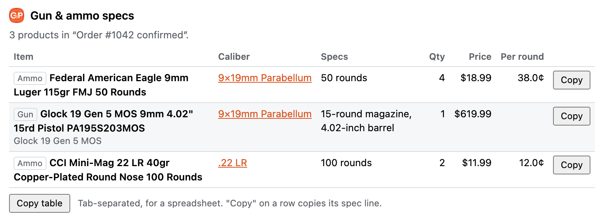

# GunsNPrices: Gun & Ammo Specs for Thunderbird

[](https://github.com/gunsnprices/thunderbird-gunsnprices/actions/workflows/ci.yml)
[](#license)

A free Thunderbird add-on that finds gun and ammunition products in an email, such as an order confirmation, a
receipt or a deal newsletter, and shows their specs in a table: firearm or ammo, model, caliber, magazine capacity,
barrel length, rounds per box, quantity, price and cost per round.



*Preview of the popup with the sample order confirmation from `test/fixtures/` (rendered from the popup's HTML).*

It runs entirely on your computer with the open source title parser of [GunsNPrices](https://gunsnprices.com), a
US gun and ammo price comparison site. The parser knows 293 calibers with the spellings stores use (`9MM LUGER`,
`5.56 NATO`, `12GA`, `300 BLK`) and the models of 50 firearm brands.

## Features

- **Gun & ammo specs** button in the message header. Click it on an order confirmation or a deal email to get a
  table of the gun and ammo products in it. Plain text and HTML emails both work.
- **Cost per round** for ammo: the price divided by the rounds in the box. Old prices (struck through, "was",
  "reg."), savings, rebates, shipping and "orders over $99" amounts are not taken as prices. When an order shows a
  line total for several boxes, it is divided by the quantity.
- **Parse gun/ammo title** in the context menu of selected text, in a message or in the compose editor. A window
  shows the specs of the selected title, or of every product in the selected lines.
- **Copy** on a row copies a spec line to paste into a message, for example
  `Glock 19 Gen 5 MOS, 9×19mm Parabellum, 15-round magazine, 4.02-inch barrel` or
  `9×19mm Parabellum, 50 rounds, 38.0¢ per round`. **Copy table** copies all rows as tab-separated text for a
  spreadsheet.
- Caliber names link to the GunsNPrices page that compares current prices for that caliber. Links open in your
  browser only when you click them.

Gear such as magazines, holsters and optics is left out, as are order totals, addresses and the usual email text.

## Privacy

- The add-on reads the displayed message only when you click its button, and selected text only when you choose its
  menu item.
- Everything is processed in Thunderbird. The add-on makes no network requests, stores nothing and has no telemetry.
- Permissions: `messagesRead` (read the displayed message when you click the button) and `menus` (the context menu
  item). No access to websites, contacts, accounts or sending.

## Install

- From [addons.thunderbird.net](https://addons.thunderbird.net/) once the listing is approved.
- From a file: build it (below), then in Thunderbird open **Tools > Add-ons and Themes**, click the gear icon, choose
  **Install Add-on From File** and pick `dist/gunsnprices-thunderbird-1.0.0.xpi`.

Requires Thunderbird 140 or newer.

To try it, open one of the sample emails in Thunderbird with **File > Open > Saved Message**:
[`test/fixtures/sample-order.eml`](test/fixtures/sample-order.eml) and
[`test/fixtures/sample-newsletter.eml`](test/fixtures/sample-newsletter.eml).

## How it works

1. `messenger.messageDisplay.getDisplayedMessages()` and `messenger.messages.listInlineTextParts()` give the text
   and HTML parts of the displayed message.
2. [`lib/html-to-text.js`](extension/lib/html-to-text.js) turns HTML into lines of text: one line per table row,
   cells separated by tabs, struck-through prices and hidden preview text removed. It works on the string; nothing
   is rendered or loaded.
3. [`lib/extract.js`](extension/lib/extract.js) reads each line and table cell with the parser. A line becomes a
   product when the parser finds a firearm model, or a caliber with a round count, capacity or barrel length, or a
   caliber and a price. The price and quantity come from the same line or the next few lines, up to the next product
   or the order summary. The text part that gives the most products is used.
4. [`popup/popup.js`](extension/popup/popup.js) shows the table.

The parser is the [`gunsnprices`](https://www.npmjs.com/package/gunsnprices) npm package
([source](https://github.com/gunsnprices/gunsnprices-js)), copied unchanged into
[`extension/vendor/gunsnprices/`](extension/vendor/gunsnprices/) with the SHA-256 of every file in
[`extension/vendor/SOURCES.txt`](extension/vendor/SOURCES.txt). Nothing is bundled, transpiled or minified: the .xpi
contains the files of `extension/` as they are in this repository.

## Limitations

- Titles from US stores, in English, with prices in dollars.
- Models are recognized for 50 brands; other brands still get the caliber and the numbers.
- Many stores leave the caliber or the round count out of the title. Then the field stays empty and there is no cost
  per round.
- Email layouts vary a lot. When the price is far from the title (another column of a complex layout), it may be
  missing. Select the lines and use **Parse gun/ammo title** to read them directly.

## Development

```bash
npm ci                 # installs the gunsnprices package (the only dependency)
npm test               # unit tests: node --test, with sample emails in test/fixtures/
npm run vendor         # copies node_modules/gunsnprices into extension/vendor/ and writes SOURCES.txt
npm run lint           # web-ext lint
npm run build          # dist/gunsnprices-thunderbird-<version>.xpi (zip of extension/)
```

`tools/preview/index.html` shows the popup in an ordinary browser with a mock of the Thunderbird API and a sample
email (see the comment at the top of the file).

CI runs the tests, checks that the vendored parser matches the npm package, lints with the
[addons-linter](https://github.com/mozilla/addons-linter) version that addons.thunderbird.net uses (6.15) and with the
current `web-ext`, and builds the .xpi. Release steps and the store listing are in [PUBLISHING.md](PUBLISHING.md).

## License

The code is under the [MIT License](LICENSE). The caliber list and model dictionaries inside the parser
(`extension/vendor/gunsnprices/src/data/`) are © GunsNPrices under [CC BY 4.0](LICENSE-DATA).

## More

The same parser for other platforms (Python, PHP, Ruby, WordPress, Joomla and more):
[gunsnprices.com/developers](https://gunsnprices.com/developers). Questions and corrections: open an issue or write
to app@gunsnprices.com.
